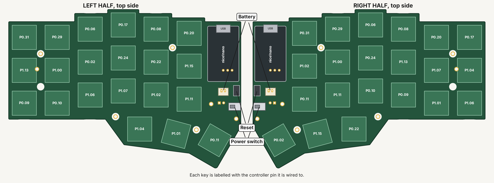
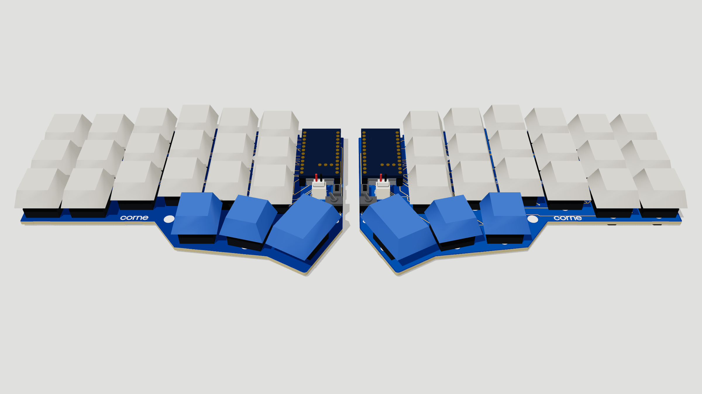
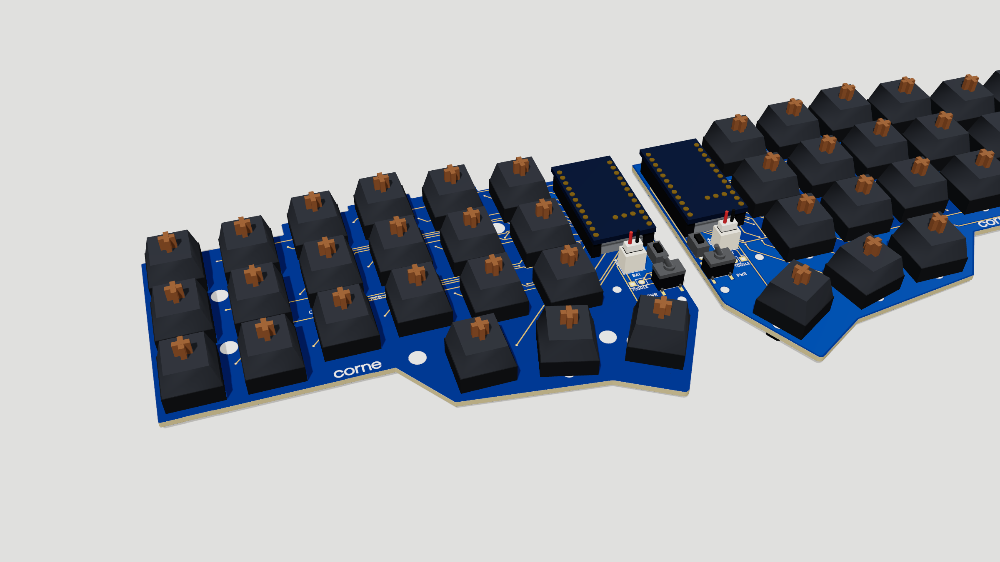
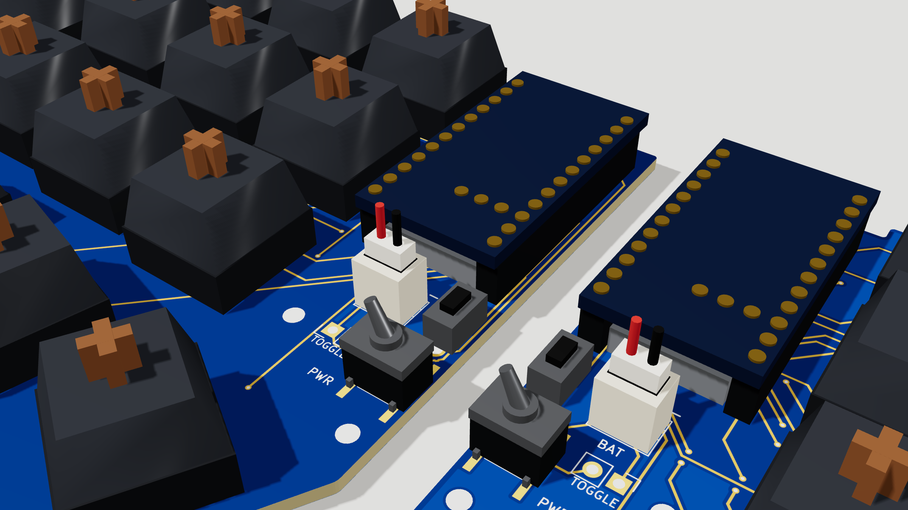
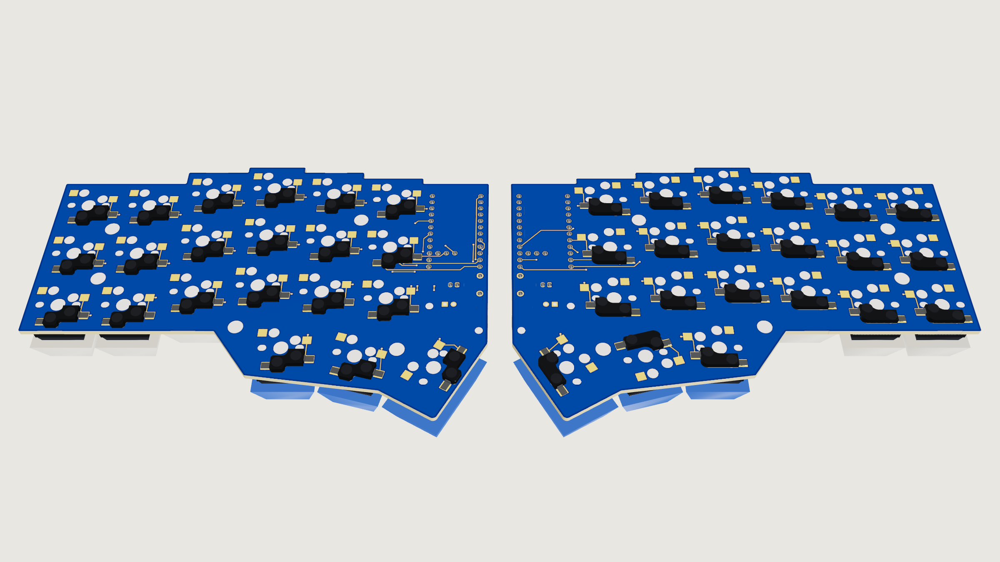
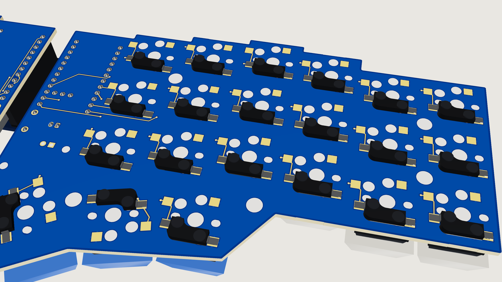
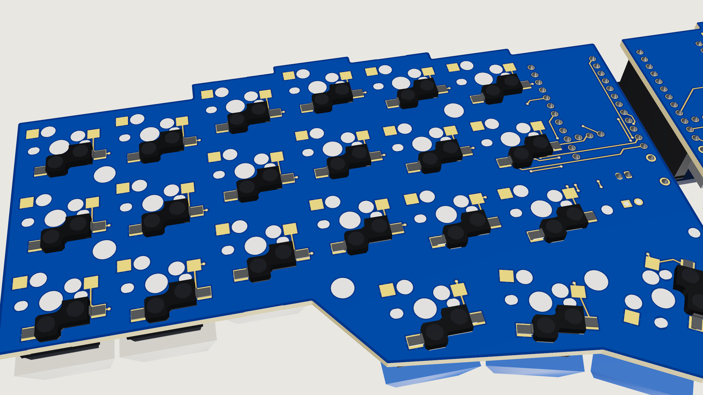
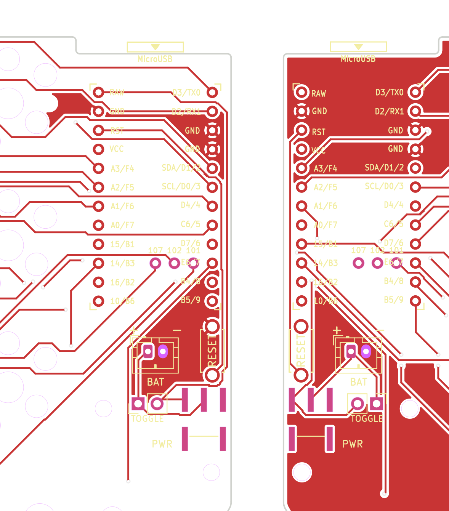

# Diodeless nRF52840 Corne v3

A diodeless (direct-pin), Bluetooth variant of the [Corne Cherry v3.0.1](https://github.com/foostan/crkbd/tree/v3-final) by foostan. This repository holds the files and instructions needed to build one.

**Status: revision 0.4. The board passes KiCad DRC for connectivity and clearance, but it has not been fabricated or tested yet. Read [Check before ordering](#check-before-ordering) first.**

## What it is

- 3x6+3 keys per half, with the same outline, key positions and mounting holes as Corne v3
- nice!nano v2 (nRF52840) running ZMK, one per half
- One GPIO per switch and no diodes. All 21 GPIOs per half are used, including the three inner pads P1.01, P1.02 and P1.07
- Every key takes either a Kailh MX hotswap socket or a Kailh Choc v1 hotswap socket
- C&K GT11MSCBE sealed toggle as the power switch, where the Corne's TRRS jack was
- No OLED, no RGB and no TRRS cable

## 3D preview

These are renders of a 3D model built from the board file. Part positions and sizes are real, but the parts are simple block models and the socket heights are typical values, not measured.

For a model you can spin around, download [`3d-viewer.html`](3d-viewer.html) and open it in a browser. It needs an internet connection the first time, to load the 3D library.

The underside, with MX hotswap sockets on one half and Choc sockets on the other for comparison. A real build uses one type per key.

| MX sockets | Choc sockets |
|---|---|
|  |  |

## Files

| Path | Contents |
|---|---|
| `gerbers/corne-diodeless-gerbers.zip` | The file to upload to a PCB manufacturer |
| `gerbers/` | The same gerber and drill files, unzipped |
| `pcb/` | KiCad 7 board, project file and footprint library, for viewing or editing |
| `BOM.md` | Parts list with part numbers and quantities |
| `PINMAP.md` | Which pin each key uses, with a ZMK key scan snippet for each half |
| `images/` | Board renders and 3D previews |
| `3d-viewer.html` | Interactive 3D model. Download it and open it in a browser |

There is no schematic. Each switch simply connects one controller pin to ground, as listed in `PINMAP.md`.

## Check before ordering

- **Power switch rating.** The GT11MSCBE is rated 0.4 VA at up to 20 V, about 95 mA at battery voltage. The nice!nano charges at about 100 mA through the switch, so the switch is at its limit while charging.
- **Inner controller pads.** The position of P1.01, P1.02 and P1.07 comes from community footprints. Check it against a real nice!nano on the 1:1 print.
- **Battery polarity.** JST-PH battery leads are not standardised. Match your battery's red wire to the + mark on the board.
- **Plates and cases.** Corne v3 plates and cases are cut for MX switches. A Choc build needs a Choc plate or no plate.

## Parts

The full parts list with part numbers and quantities is in [`BOM.md`](BOM.md).

## Ordering the PCB

Upload `gerbers/corne-diodeless-gerbers.zip`. It is a two-layer board, 1.6 mm thick. The file is a panel that holds both halves, so some manufacturers will price it as more than one design.

## Assembly

1. **Break the halves out** of the frame and file the tab edges smooth.
2. **Hotswap sockets, on the back.** Each key has two pairs of pads: the MX pair on one side of the switch centre and the Choc pair on the other. Solder sockets to one pair only. See the picture below.
3. **Power switch, on the top.** Solder the GT11MSCBE to the pads marked PWR at the inner edge. The three pads on one side are the contacts and the two on the other side hold it down. The pads match the land pattern in the C&K GT series datasheet (0.76 x 3.17 mm pads at 2.54 mm pitch, 8.38 mm across). The lever throws toward and away from the board edge.
4. **Reset button, on the top**, at the pads marked RESET.
5. **Battery connector, on the top**, at the pads marked BAT. Skip this if you will solder the battery leads straight to the pads.
6. **Controller sockets, on the top.** Fit the two 12-pin rows, and the three single sockets in the holes marked 107, 102 and 101.
7. **Controller.** Solder pins to the nice!nano, including the three inner pads, and plug it in face down, with the components toward the PCB and the USB port at the top edge.
8. **Battery.** With the power switch off, connect the battery, checking + and -.
9. **Switches and keycaps.**

### Using a different power switch

Two holes marked TOGGLE sit next to the power switch and are wired in parallel with it. To use an off-board switch, leave the PWR pads empty and wire your switch across those two holes.

## Firmware

The board runs [ZMK](https://zmk.dev) with its direct-pin key scan driver. `PINMAP.md` lists the pin for every key and gives a ready `kscan` block for each half. A complete ZMK configuration for this board has not been written yet.

After flashing, press every key once to confirm all 21 pins on each half respond. A dead key on one of the three inner pads usually means that pin is not making contact.

## Power notes

- The switch disconnects the battery completely. With it off, the battery will not charge over USB.
- Turn the switch off before plugging or unplugging the battery.

## Licence and credit

Based on the Corne keyboard by foostan, used under the MIT licence. See `LICENSE`.
